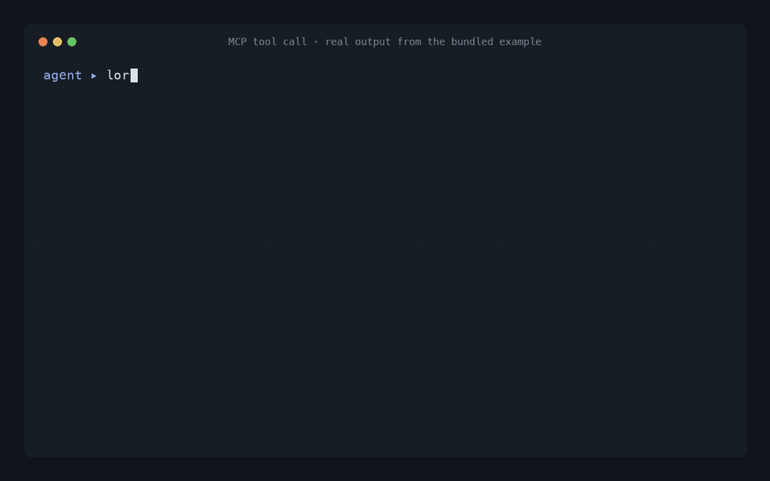

# lore

**A local, traceable project memory for AI coding agents.**



Your project's knowledge is scattered across Markdown: ADRs, runbooks, a docs folder, an Obsidian
vault, the memory files Claude Code and Codex write for themselves. Agents either can't see it, or
you paste half of it into every prompt and burn tokens.

lore indexes those Markdown files **locally**, understands which decisions are still in force, and
hands your agent a **small, cited context pack** over [MCP](https://modelcontextprotocol.io) —
every snippet comes with the file, heading and line it came from.

```
> lore_get_context("how are orders stored")        # bundled example, JSON trimmed for reading

chunks
  docs:ARCHITECTURE.md        › Architecture                                  score 1.00
  docs:known-issues.md        › Known issues                                  score 0.73
  docs:adr/0001-use-mysql.md  › ADR-0001 — Use MySQL 8 for the orders database score 0.69
decisions
  ADR-0004  Move orders to PostgreSQL 16                      active      cited in ARCHITECTURE.md line 17
  ADR-0001  Use MySQL 8 for the orders database               superseded  by ADR-0004
  ADR-0003  Publish order events through a transactional outbox  active
  ADR-0002  Keep API, workers and web in one repository       active
omitted
  5 chunks below the minimum score
```

## Why lore

- **Decisions with state, not just text.** lore reads your ADRs (`ADR-0001`, `docs/adr/0001-*.md`,
  `DEC-001`) and knows which are `active`, `proposed`, `superseded`, `deprecated` or `undeclared` — from what is
  *written* ("Status: Superseded by ADR-0004", "This decision supersedes ADR-0001"), never guessed.
  Your agent stops recommending the database you migrated away from last year.
- **Everything is traceable.** Every chunk, graph edge and category carries its evidence: source,
  path, heading, line. Categories say whether they are *explicit* (the source says so) or a
  *suggestion*.
- **Small context, on purpose.** The Context Builder returns a few relevant chunks plus decisions,
  memories and entities under hard limits you control, and tells the agent what it left out.
- **Agents can remember — safely.** `lore_remember` only *creates* a new Markdown memory with
  evidence, marked unverified. `lore_forget` moves it to a recoverable trash. Your sources are
  read-only, always.
- **Walls between projects.** Each MCP process is pinned to a *domain*: the agent working on
  project A never sees project B's documents or memories.
- **Private by default.** Runs on `127.0.0.1` only. A `privacy.yaml` denies secret-looking files and
  keeps sensitive documents out of MCP; outgoing text is scrubbed for keys and tokens. No cloud, no
  telemetry, no embeddings service.
- **Git-aware.** Read a repository *at a ref* (`origin/main`) instead of your dirty working tree, so
  the agent sees what is actually shipped.
- **A UI to see what your agent sees.** Search, document explorer, knowledge graph, decision list,
  MCP usage panel and an append-only audit log.

## Quick start

Requirements: Python 3.12+ with [uv](https://docs.astral.sh/uv/), Node 20+ (only to build the UI), git.

```bash
git clone https://github.com/henriquemharth/lore.git
cd lore
scripts/lore.sh build                 # backend deps + UI build
uv tool install --editable ./backend  # puts `lore` and `lore-mcp` on your PATH
```

Try it on the bundled example (a fictional e-commerce backend with five ADRs):

```bash
cd examples/acme-shop
lore index && lore serve              # http://127.0.0.1:8610
```

Open <http://127.0.0.1:8610> and search for `orders`.

### Use it on your own project

```bash
cd ~/code/my-project
lore init          # writes sources.yaml, taxonomy.yaml and privacy.yaml (repo at HEAD, or ./docs)
lore index         # builds the local index in ./.lore
lore serve         # optional: UI at http://127.0.0.1:8610, re-syncs sources every 5 minutes
```

Edit `sources.yaml` to point at whatever holds your knowledge — a docs folder, an Obsidian vault,
`~/.claude/projects/<project>/memory`, `~/.codex/memories`, or a git repo at a ref. Add `.lore/` and
`memories/` to your `.gitignore` if you don't want to commit them.

### Connect your agent

The MCP server reads the index; it never builds it. Run `lore index` (or keep `lore serve` running)
first. Started from the project folder, `lore-mcp` picks up its `sources.yaml` automatically.

**Claude Code** (run inside the project)

```bash
claude mcp add lore -- lore-mcp
```

**Codex** (`~/.codex/config.toml`)

```toml
[mcp_servers.lore]
command = "lore-mcp"
env = { LORE_SOURCES_FILE = "/path/to/my-project/sources.yaml" }
```

**Cursor / any MCP client** (`mcp.json`)

```json
{
  "mcpServers": {
    "lore": {
      "command": "lore-mcp",
      "env": { "LORE_SOURCES_FILE": "/path/to/my-project/sources.yaml" }
    }
  }
}
```

Set `LORE_MCP_DOMAIN` in the server's `env` to pin it to one project (see [Domains](docs/MCP.md#domains)).

## MCP tools

| Tool | What it does |
|---|---|
| `lore_get_context` | **Start here.** A small pack for a task: chunks, decisions, memories, entities, sources, each with its origin |
| `lore_search` | Full-text search (accent/case-insensitive, stemming, exact codes and hashes, quoted phrases) |
| `lore_get_document` | Read a document, or only some of its chunks |
| `lore_get_decisions` | Decisions and their state: `active`, `proposed`, `superseded`, `deprecated`, `undeclared` |
| `lore_get_entity` | A node of the graph — decision, document, category, commit, migration, file — with evidence |
| `lore_status` | What is indexed, when, and what the limits are |
| `lore_remember` | Create a new, unverified memory with evidence (can be disabled) |
| `lore_forget` | Move a memory created by `lore_remember` to the trash (can be disabled) |

## How it works

```
 Sources (.md, read-only)          lore (local)                                      Who uses it
 ┌─────────────────────────┐   ┌─────────────────────────────────────────────┐
 │ docs/ folder            │   │ scanner (folder / git at a ref, privacy)    │
 │ ADRs                    │──▶│ parser · chunking by heading · mentions     │──▶ UI  127.0.0.1:8610
 │ Obsidian vault          │   │ SQLite FTS5 · evidence graph · decisions    │──▶ lore-mcp (stdio) →
 │ Claude / Codex memories │   │ Context Builder · append-only audit         │      Claude Code, Codex,
 │ git repo @ origin/main  │   │ domain wall per MCP process                 │      Cursor, …
 │ memories/ (agent-made)  │   └─────────────────────────────────────────────┘
 └─────────────────────────┘
```

- Indexing is incremental by sha256: unchanged files are skipped, changed files get a new version,
  removed files leave the search but keep their history.
- The graph only contains what is **written**: a decision code, a commit hash or a file path in a
  document creates an edge, with the line as evidence. Nothing is inferred from topic similarity.
- See [docs/GRAPH.md](docs/GRAPH.md), [docs/MCP.md](docs/MCP.md) and the HTTP API in
  [docs/CONTRACT.md](docs/CONTRACT.md).

## Configuration

Three YAML files (generated by `lore init`) and optional `LORE_*` environment variables:

- `sources.yaml` — which folders and repositories to read, grouped by domain.
- `taxonomy.yaml` — the category tree and rules (explicit vs. suggested).
- `privacy.yaml` — files never read, and documents never sent over MCP.

All variables are listed in [docs/CONTRACT.md](docs/CONTRACT.md#environment-variables).

## Roadmap

- [ ] Optional local embeddings for hybrid search
- [ ] `pip install lore-mcp` / `uvx` packaging with the UI bundled
- [ ] Docker image
- [ ] Importers for Notion and Confluence exports

## Contributing

Issues and PRs are welcome — see [CONTRIBUTING.md](CONTRIBUTING.md).

## License

[MIT](LICENSE)
